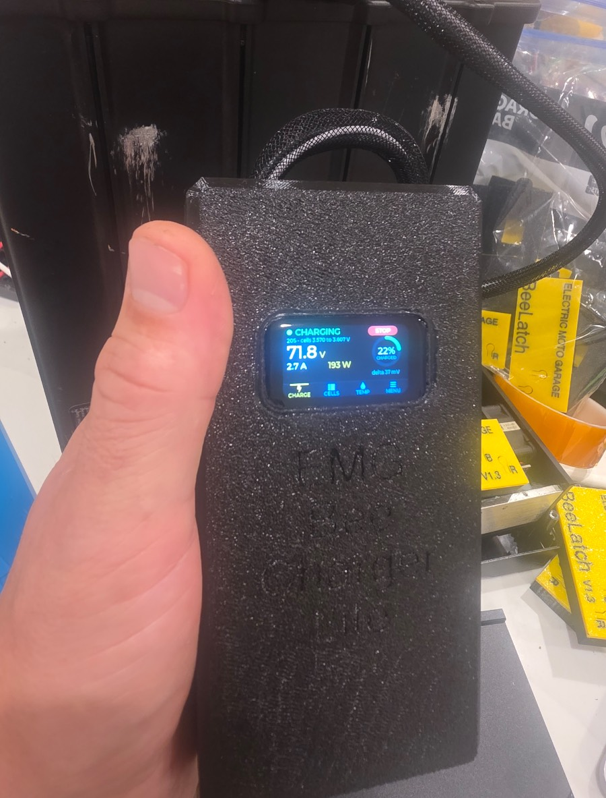
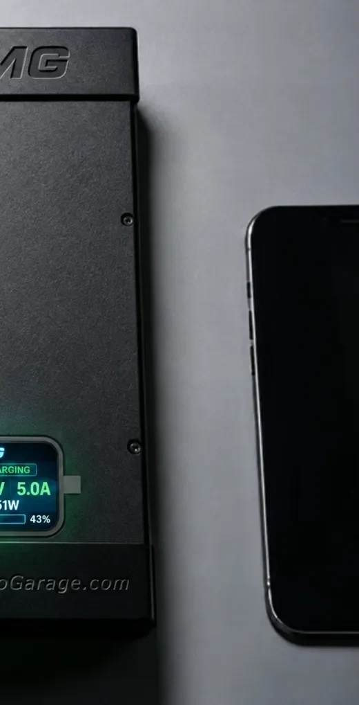

# Bee Chargers

**Chargers for the Ultra Bee and Light Bee 2, including a touchscreen model with built-in diagnostics.**

 

## What I built
- A line of chargers covering the bikes' different charge-port styles, plus a J1772 (EV station) adapter.
- **Bee Charger Touch:** a touchscreen controller showing live charge data, cell information and diagnostics, with a built-in web interface.
- **Reviver mode:** tries to safely wake a battery that has shut itself off and won't accept a normal charge.

## Engineering focus
- High-voltage safety: limits, timeouts, and failing to "off".
- Measuring how the battery actually behaves before deciding when it's safe to charge.

## Status
Shipping. https://electricmotogarage.com/products/emg-chargers/
