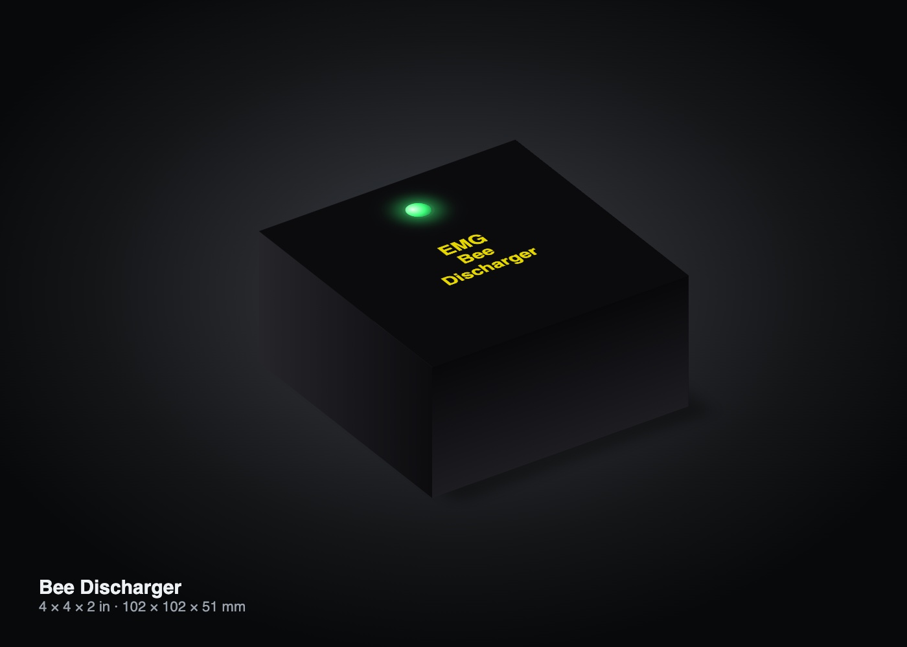

# Bee Discharger

**Controlled discharge and capacity testing for high-voltage motorcycle batteries.**

## What I built
- An ESP32-controlled resistive load that drains a pack safely, for storage, shipping or capacity tests.
- A web interface for live voltage, current, temperature and run progress.
- Logging, so a full run gives a capacity figure for battery health.

## Engineering focus
- Heat management and automatic shutoff limits.
- A test procedure that can be repeated pack after pack, for battery repair work.

## Status
Experimental.
