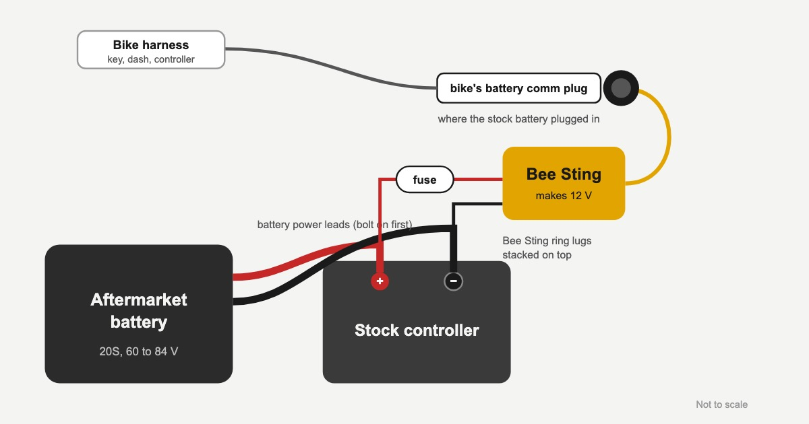
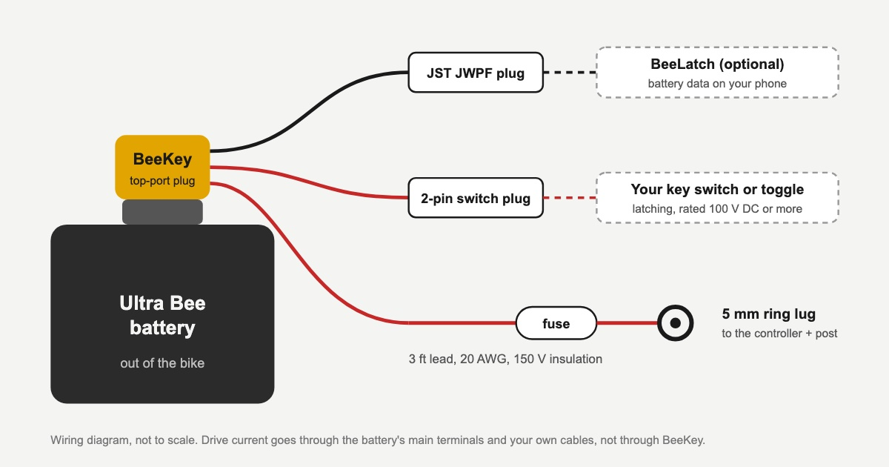

# Bee Sting & BeeKey

**Small boxes that solve power-up problems for aftermarket batteries and battery-only builds.**

## Bee Sting
An Ultra Bee running an aftermarket battery can lose the 12 V it needs to switch on. Bee Sting supplies it, using two ring lugs and one plug.

https://electricmotogarage.com/products/bee-sting/

## BeeKey
Runs an Ultra Bee battery outside the bike, for go-karts, inverters and custom builds, switched on and off with your own key switch.

https://electricmotogarage.com/products/beekey/

## Engineering focus
Harness design, safe power-up order, and builds that a customer can install with simple tools.
