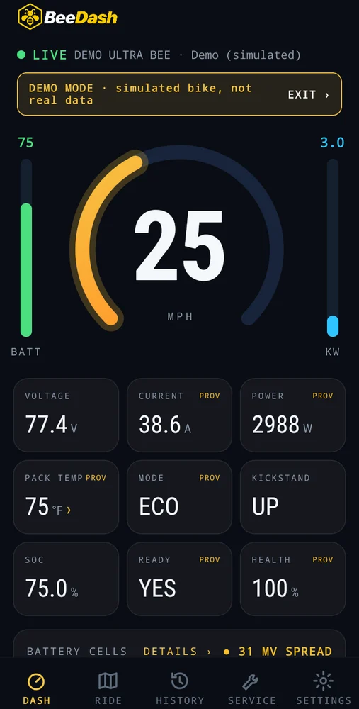
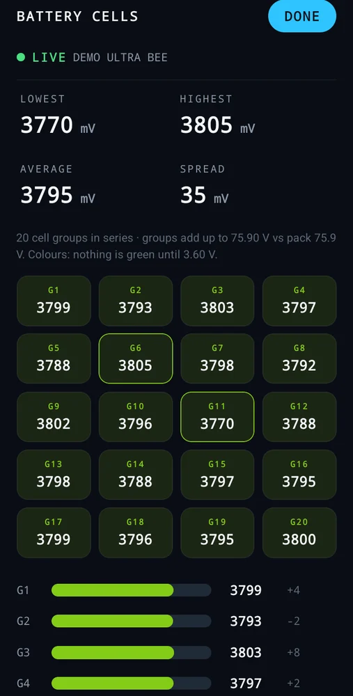
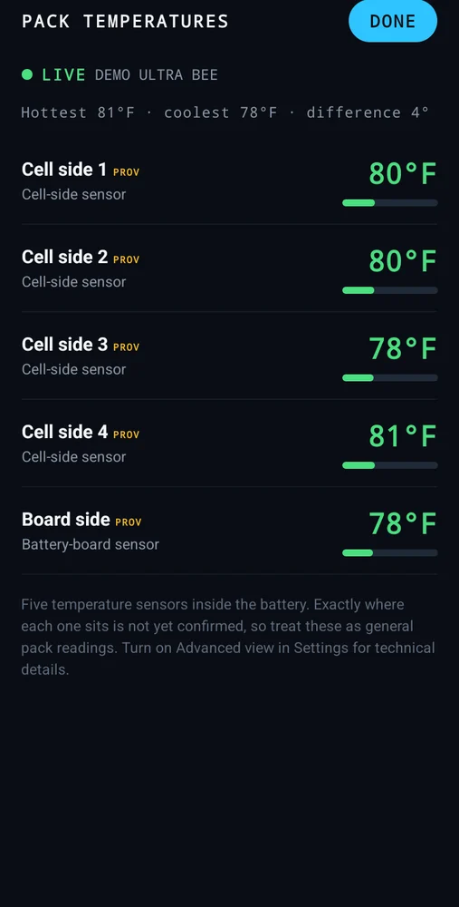

# BeeDash app

**Phone dashboard and diagnostics for electric motorcycles: pack voltage, every cell group, temperatures and GPS ride logs.**

  

## What I built
- A React Native (Expo) app for Android and iPhone.
- Connects over Bluetooth to [BeeLatch](beelatch.md).
- Live gauges, a cell-balance view, temperature tracking and recorded rides with GPS.
- A browser demo where you can twist a simulated throttle and replay a real ride: https://electricmotogarage.com/beedash/demo/

## Status
Android download and iPhone TestFlight beta. https://electricmotogarage.com/beedash/app/
