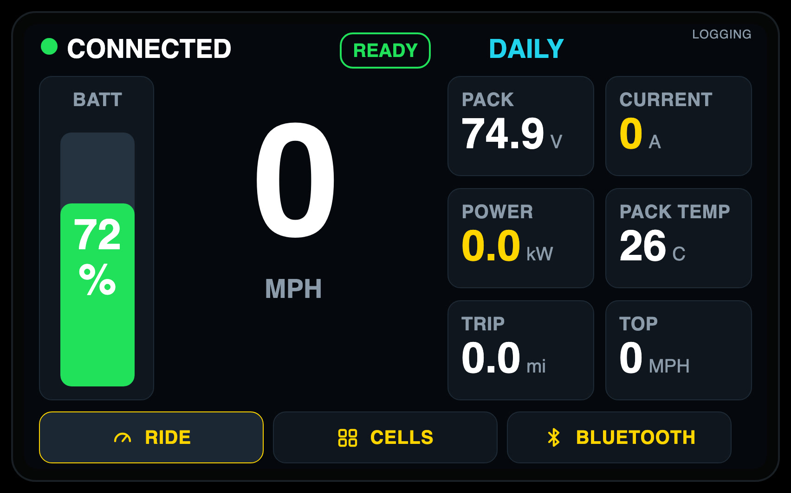
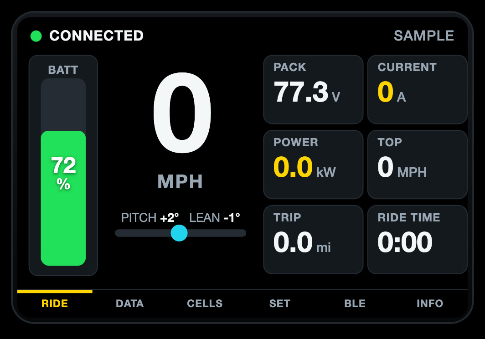

# BeeDash HUD

**Color touchscreen speedometers for the Ultra Bee, with support for Fardriver and VESC controllers and ANT BMS batteries.**

## What I built
- Two sizes: a 3.5″ touch display (ESP32-S3) and a 4.3″ 500-nit "Bright" display (ESP32-P4) for direct sun.
- Interfaces built in LVGL: speed, battery, power, temperatures, ride modes.
- Works wired straight to the bike's CAN bus, or wirelessly through BeeLatch.
- One firmware that handles several controller and battery families.

## Interesting problems
- Staying readable in direct sun at a glance while riding.
- Smooth gauges on a microcontroller without dropping incoming data.
- Clear warnings when a data source goes quiet.

## Status
Made to order. https://electricmotogarage.com/products/beedash-hud/
