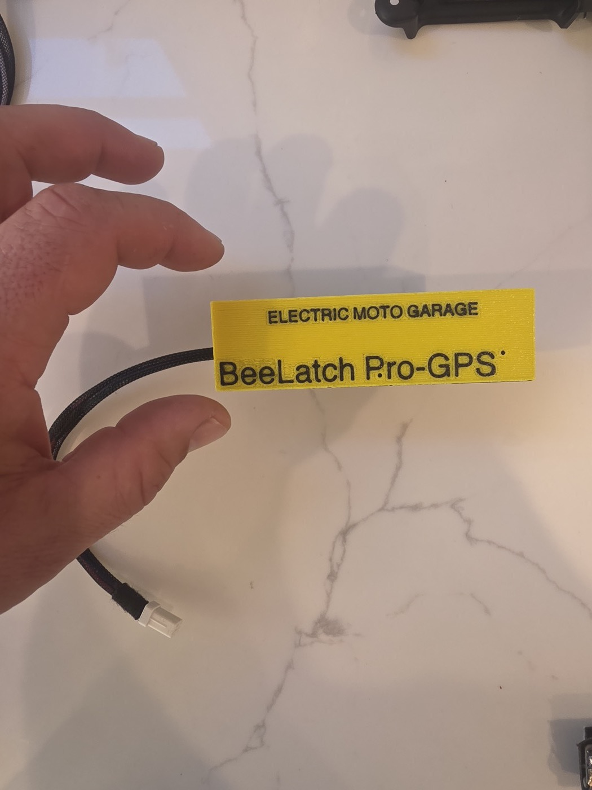

# BeeLatch Pro

**GPS and 4G tracker for the Ultra Bee: live location, battery status and alerts.**

## What I built
- ESP32-S3 with a 4G/LTE cellular modem and GPS.
- Reports live location and battery state over cellular. Data costs the rider $5 a month.
- Arm/disarm with alerts: a GPS geofence catches the bike being moved, and the key being switched on while armed triggers an alert.
- Firmware written in ESP-IDF, with over-the-air updates.

## Design decisions
- Privacy first: location data belongs to the rider.
- Motion with the key off is invisible to the bike's own electronics, so the design relies on GPS rather than bike data to detect theft.

## Status
Made to order. Product page: https://electricmotogarage.com/beedash/beelatch-pro/
