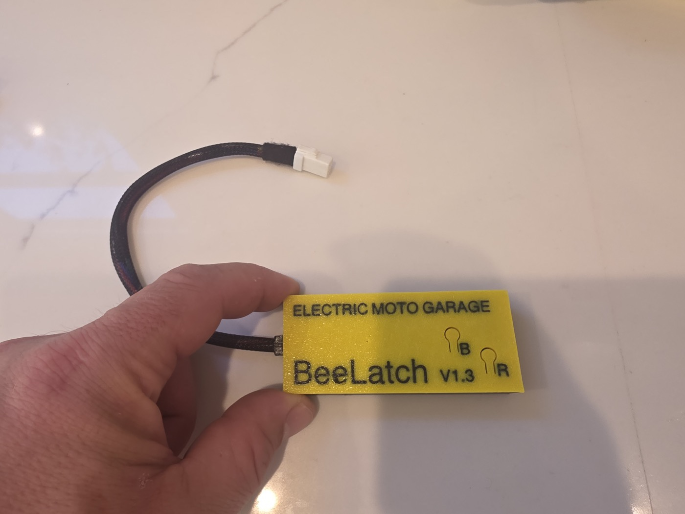

# BeeLatch

**A plug-in CAN bus module that replaces the Ultra Bee's T-Box and streams live battery data to your phone.**



## The problem
The bike knows a lot about its battery: pack voltage, every cell group, temperatures. Riders can't see any of it. The factory telematics box doesn't help most owners.

## What I built
- A small ESP32-based module that plugs into the factory T-Box connector. No cutting or splicing.
- It **listens only**. It never sends commands to the bike.
- Data goes over Bluetooth to the [BeeDash app](beedash-app.md) and to the [BeeDash HUD](beedash-hud.md).
- Wi-Fi setup mode and over-the-air firmware updates.

## How it works (high level)
```
Bike CAN bus ──► CAN transceiver ──► ESP32 (decode, filter, check data is fresh) ──► BLE ──► phone / HUD
```

## Interesting problems
- Working out what the bike's data means, by capturing and comparing many hours of real rides and charges.
- Showing "no data" honestly instead of freezing on old numbers when the link drops.
- Small and cheap enough to sell, tough enough to live on a dirt bike.

## Status
Shipping. Product page: https://electricmotogarage.com/beedash/beelatch/
